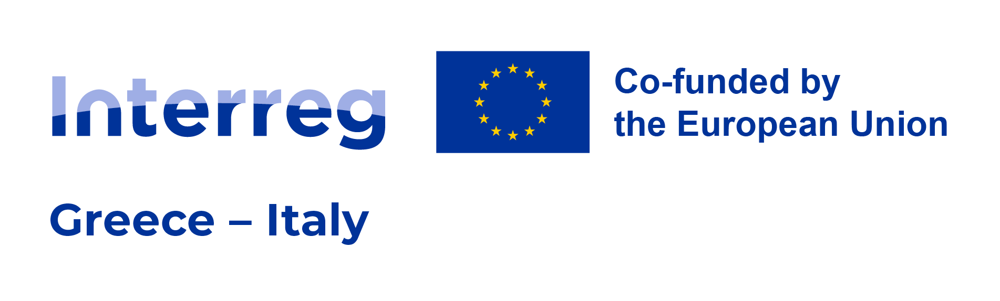
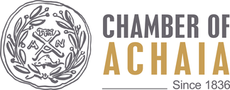
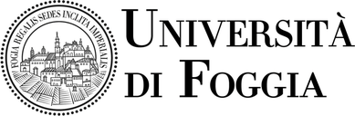

# HELIX-SMART

**excellence Hubs Enhancing Linkages and Innovation for X-border ecosystems and SMART transition**

HELIX-SMART is a cross-border initiative advancing digital transformation and sustainable growth for
SMEs and freelancers in Greece and Italy, focusing on ICT, tourism and the blue economy. It is
co-funded by the European Union under the **Interreg VI-A Greece–Italy 2021-2027** Programme
(Priority 1 “Smart and Innovation”, Specific Objective 1.1 “Research and Innovation”) through the
European Regional Development Fund.

## Services

| Service | Link | Repository |
|---|---|---|
| **Digital Twin** of the Greece–Italy cross-border innovation ecosystem: actors, maturity, needs, collaboration network, collaboration opportunities | [helix-smart.di.ionio.gr/digital-twin](https://helix-smart.di.ionio.gr/digital-twin/) | `digital-twin` (private for now) |

More services will be added side by side under [helix-smart.di.ionio.gr](https://helix-smart.di.ionio.gr/).

## Partnership

<!-- Logos at most 48 px high: the EU flag in the programme logo above (150 px) is ~50 px,
     and must stay the largest logo (Interreg visibility rules). -->

  &nbsp;&nbsp;
  &nbsp;&nbsp;
  &nbsp;&nbsp;
  &nbsp;&nbsp;
  &nbsp;&nbsp;
  &nbsp;&nbsp;

| Partner | Role | Location |
|---|---|---|
| [Ionian University](https://ionio.gr) | Lead Beneficiary | Corfu, Greece |
| [Chamber of Achaia](https://www.e-a.gr) | Partner | Patras, Greece |
| [ATHENA Research and Innovation Centre – Industrial Systems Institute](https://www.athenarc.gr) | Partner | Patras, Greece |
| [University of Foggia](https://www.unifg.it) | Partner | Foggia, Italy |
| [CNA – National Confederation of Crafts and SMEs, Provincial Association of Brindisi](https://www.cna.it/chi-siamo/trova-sede/puglia/brindisi/) | Partner | Brindisi, Italy |
| [GAL BaTiR – Local Action Group Basso Tirreno Reggino](https://www.galbatir.it) | Partner | Villa San Giovanni, Italy |

## Development

The software in this organisation is designed and developed by the
[Department of Informatics](https://di.ionio.gr), [Ionian University](https://ionio.gr).

**Contributors**

<!-- One line per person: name, role, affiliation. Add a GitHub link only with the person's consent. -->
- *Name Surname*: role (e.g. project coordinator, scientific lead, developer), Department of Informatics, Ionian University

## Funding and disclaimer

HELIX-SMART is co-funded by the European Union under the Interreg VI-A Greece–Italy 2021-2027
Programme. The content of these repositories and services is the sole responsibility of the
HELIX-SMART partnership and does not necessarily reflect the views of the European Union or the
Programme bodies.

[Project page on greece-italy.eu](https://www.greece-italy.eu/project/helix-smart-excellence-hubs-enhancing-linkages-and-innovation-for-x-border-ecosystems-and-smart-transition/)
· [Interreg Greece–Italy Programme](https://www.greece-italy.eu/)
